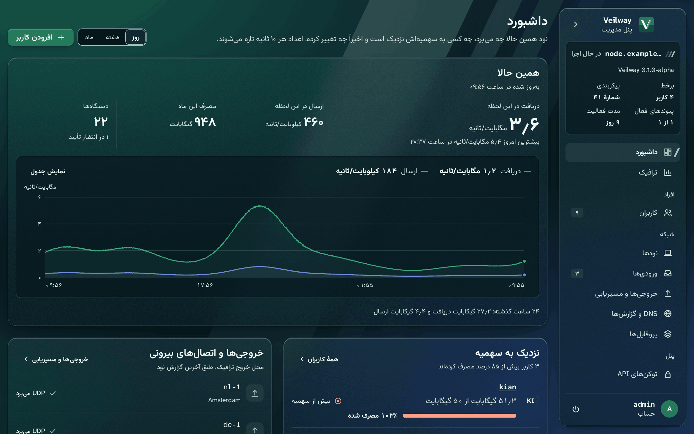
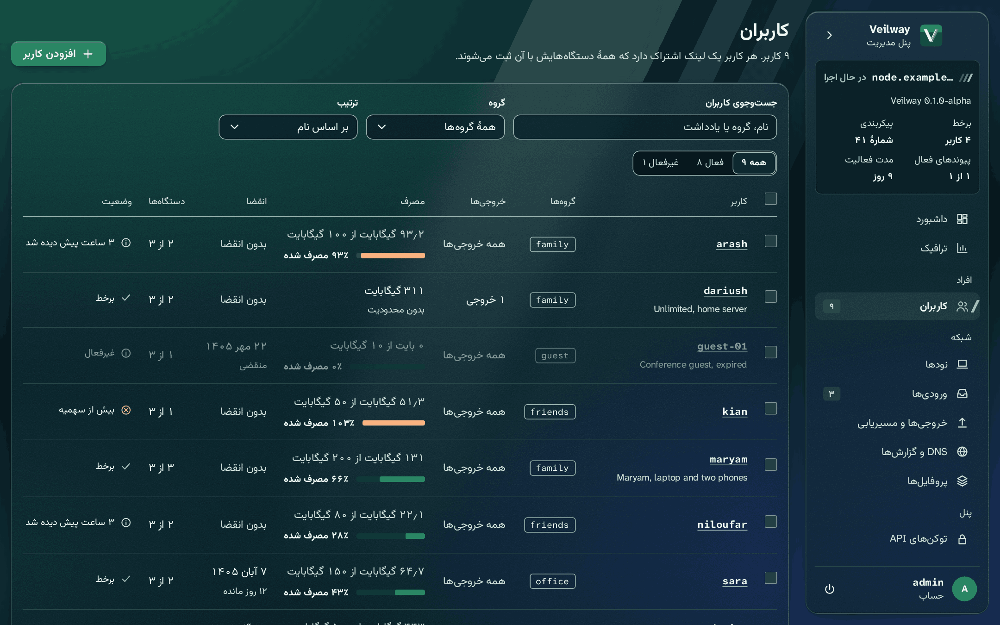

<p align="center">

</p>

<h1 align="center">پنل Veilway</h1>

<p align="center" dir="rtl">
پنل مدیریت یک گرهٔ Veilway: کاربران، دستگاه‌ها، لینک‌های اشتراک و یک API.
</p>

<p align="center">
<a href="README.md">English</a> | <b>فارسی</b>
</p>

<p align="center">
<a href="LICENSE"></a>
<a href="https://t.me/VeilwayGroup"></a>
</p>

<div dir="rtl">

## تصاویر

داشبورد در پوستهٔ تیره، به فارسی.



فهرست کاربران.



صفحهٔ یک کاربر: مصرف، دستگاه‌ها و لینک اشتراک.


ترافیک.


ورودی‌ها.


داشبورد در پوستهٔ روشن.


## این مخزن چیست

Veilway یک پلتفرم VPN متن‌باز برای کسانی است که پشت شبکه‌های سانسورشده هستند. یک هستهٔ Rust دارد، یک پنل وب و برنامه‌های رسمی. پنل بخش مدیریت یک گره است. این بخش یک سرور Rust با SQLite است، به‌همراه یک برنامهٔ React که در همان فایل اجرایی ساخته می‌شود. پنل روی میزبان گره اجرا می‌شود و کاربران و تنظیمات را از راه API کنترل گره، روی سوکت unix آن، تغییر می‌دهد.

- کاربران و دستگاه‌ها: سهمیه برای هر دوره، تاریخ انقضا، گروه‌ها، فعال و غیرفعال کردن، کلید دستگاه، بازنشانی مصرف، و لینک‌ها و کدهای QR اشتراک.
- اشتراک‌ها و کلیدهای دروازه: درخواست‌ها و پاسخ‌ها از ابتدا تا انتها با کلید دروازهٔ پنل رمز می‌شوند، پس آینه‌های رله چیزی از محتوایشان نمی‌بینند. لینک‌ها کلید دروازه را دارند. صفحهٔ چرخش کلید، و کاری برای کلیدی که دزدیده یا گم شده، در خود پنل است. نقطه‌های پایانی نام‌دار در `sub_path/<name>` در دسترس‌اند. می‌توانید آن‌ها را برای هر کاربر و هر گروه تعیین کنید، و جابه‌جایی میان‌شان امضا می‌شود. یک نقطهٔ پایانی می‌تواند `http://` ساده باشد. در این حالت پنل هشدار می‌دهد.
- ورودی‌ها، خروجی‌ها و مسیریابی: ورودی‌های بومی و افزونهٔ اختیاری Xray. کلیدها با دکمهٔ «ساخت کلید» ساخته می‌شوند. هر ورودی نشانی‌های خودش را دارد. یک خروجی پیش‌فرض هست، با خروجی‌هایی برای هر کاربر. قانون‌های مسیریابی را با کشیدن و رها کردن مرتب می‌کنید. یک ویرایشگر JSON خام هر تغییر را با طرح تنظیمات می‌سنجد.
- چند سرور: سرورهای دیگر از راه پیوند گره می‌پیوندند، هر کدام با بازهٔ نشانی خودش. اشتراک هر کاربر سرورهایی را که می‌تواند استفاده کند فهرست می‌کند و مصرفش روی همهٔ آن‌ها جمع زده می‌شود، و با رسیدن به سهمیه روی همهٔ سرورها قطع می‌شود.
- پیوندهای گره و آینه‌ها: راه‌اندازی راهنمایی‌شده برای گرهٔ ورودی و تونل معکوس، رله‌ها، و آینه‌های رله و ایستا. نشانی نود و نشانی رله‌ها می‌توانند IP یا نام میزبان باشند. پنل هر بار که اشتراک یک کاربر را می‌سازد، نام را جست‌وجو می‌کند، پس برنامه‌ها همیشه نشانی IP می‌گیرند.
- ترافیک، DNS، گزارش‌ها و اعلان‌ها: ترافیک زنده و گذشته برای هر کاربر، هر ورودی، هر خروجی و هر مسیر بیرونی. همچنین تنظیمات DNS، گزارش‌ها، و اعلان‌ها برای همهٔ دستگاه‌ها.
- مدیران و دسترسی: ورود با گذرواژه و کد TOTP، نشست‌ها، محدودیت تعداد درخواست، توکن‌های API، و گزارش ممیزی. API مدیریتی با `server/openapi.json` توصیف می‌شود.
- عملیات: پشتیبان‌گیری و بازیابی. دکمه‌های به‌روزرسانی پنل و نود، و دکمه‌های راه‌اندازی دوباره در صفحهٔ نودها. نصب‌هایی که با اسکریپت نصب انجام شده‌اند این دکمه‌ها را دارند و به‌روزرسان، خود اسکریپت را هم به‌روز نگه می‌دارد. لینک به صفحه‌های شرایط و حریم خصوصی خودتان. حالت نمایشی با ورود دومرحله‌ای خاموش (`"two_step": "off"` فقط در `panel.json`) که یک هشدار ثبت می‌کند. انگلیسی و فارسی، در پوستهٔ روشن و تیره.

## برای چه کسانی است

برای اپراتورهایی که یک گرهٔ Veilway را اجرا می‌کنند و می‌خواهند کاربرانشان را از مرورگر یا با اسکریپت مدیریت کنند. وب‌سرور شما جلوی پنل می‌ماند. TLS را خودش تمام می‌کند، مسیر مدیریت و مسیر اشتراک را به پنل می‌فرستد، و بقیهٔ مسیرها را با خطای 404 خودش جواب می‌دهد. پنل فقط روی loopback گوش می‌دهد و کوکی‌هایش امن هستند.

## وضعیت

> **آلفا.** نسخهٔ فعلی `v0.3.6-alpha` است. سرور و برنامهٔ وب در آزمون آلفا با یک گرهٔ واقعی اجرا می‌شوند. پنل هیچ بررسی امنیتی بیرونی نداشته است. فایل‌ها در [صفحهٔ انتشارها](https://github.com/veilway-project/veilway-panel/releases) هستند. راهنماها و یادداشت‌های انتشار در [سایت مستندات](https://veilway-project.github.io/veilway-docs/) هستند.

## شروع سریع

اسکریپت نصب راه پیشنهادی است. گره، پنل یا هر دو را نصب می‌کند، هر دانلود را بررسی می‌کند، و می‌تواند وب‌سرور را هم برایتان راه بیندازد:

</div>

```
curl -fsSL https://raw.githubusercontent.com/veilway-project/veilway/main/scripts/veilway.sh | sudo bash
```

<div dir="rtl">

[راهنمای نصب](https://veilway-project.github.io/veilway-docs/getting-started/) جزئیات را دارد. [اولین ورودی و کاربر](https://veilway-project.github.io/veilway-docs/guides/first-user/) از اولین ورود تا لینک یک کاربر را نشان می‌دهد. برای اجرای پنل از روی سورس، اول آن را بسازید (بخش زیر). بعد، داخل `server/`:

۱. فایل `panel.json` را بنویسید. همهٔ کلیدها اختیاری هستند، ولی پنل شروع نمی‌شود مگر `trusted_proxies` وب‌سرور شما را فهرست کرده باشد. اگر پروکسی‌ای جلوی پنل نیست، `direct` را برابر `true` بگذارید. برای `prefix` یک مسیر تصادفی و بلند بگذارید، چون مسیر مدیریت است. برای `not_found` وضعیت، سرآیندها و بدنهٔ خطای 404 وب‌سرور خودتان را همان‌طور که هست کپی کنید.
۲. پنل را اجرا کنید:

</div>

```
cargo run -- run --config panel.json
```

<div dir="rtl">

در اولین اجرا، یک توکن راه‌اندازی یک‌بارمصرف در کنسول چاپ می‌شود. آن را خصوصی نگه دارید.

۳. اولین حساب مدیر را بسازید. توکن را همراه با نام کاربری، گذرواژه و `"accepted_terms": true` به `{prefix}/api/setup` بفرستید. پنل در راه‌اندازی، پذیرفتن شرایط Veilway را لازم می‌داند. پاسخ یک راز TOTP دارد. آن را به یک برنامهٔ احراز هویت اضافه کنید و با کد آن وارد شوید.
۴. پیش از افزودن کاربر، در تنظیمات، نشانی نود، نشانی نقطهٔ پایانی و استخر نشانی را بگذارید. بعد یک ورودی اضافه کنید و پروفایلش را منتشر کنید. دکمه‌های «ساخت کلید» کلید خصوصی و کلید ترابرد ورودی را می‌سازند و پنل نیمهٔ عمومی را خودش پر می‌کند. پس لازم نیست `veilway genkey` را اجرا کنید.
۵. برای ورود، `{prefix}` را در مرورگر باز کنید.

## ساخت از روی سورس

مخزن هستهٔ Veilway را کنار این مخزن کلون کنید. سرور `veilway-proto` را از `../../veilway/crates` می‌خواند، پس دو پوشه باید کنار هم باشند:

</div>

```
git clone https://github.com/veilway-project/veilway
git clone https://github.com/veilway-project/veilway-panel
cd veilway-panel
```

<div dir="rtl">

آزمون‌ها را در Docker اجرا کنید:

</div>

```
docker run --rm --cpus 3 --memory 3g -v "$PWD":/w/veilway-panel -v "$PWD/../veilway":/w/veilway -v veilway-cargo:/usr/local/cargo/registry -v veilway-target-usage:/t -w /w/veilway-panel/server -e CARGO_TARGET_DIR=/t/target/panel rust:1 sh -c "cargo test"
```

<div dir="rtl">

بعد از تغییر یک مسیر یا یک نوع، `server/openapi.json` را با همان دستور بسازید. فقط به جای `cargo test` از `sh -c "cargo run -- openapi > openapi.json"` استفاده کنید. اگر این فایل قدیمی باشد، یک آزمون شکست می‌خورد.

## اجرا با Docker

اسکریپت نصب راه پیشنهادی است و Docker یک گزینه است. تصویرهای linux/amd64 و linux/arm64 با هر برچسب `v*` در `ghcr.io/veilway-project/veilway-panel` منتشر می‌شوند. تصویر با کاربر غیر root اجرا می‌شود و تنظیمات و داده‌هایش در volumeها هستند. پنل فقط روی `127.0.0.1` گوش می‌دهد، پس یک وب‌سرور با TLS جلویش لازم است، و به سوکت کنترل گره هم نیاز دارد.

کانتینر را با سیاست راه‌اندازی دوباره اجرا کنید: `--restart unless-stopped` یا در compose مقدار `restart: unless-stopped`. بعد از بازیابی از یک پشتیبان، پنل خودش با کد خروج 75 می‌ایستد تا سیاست راه‌اندازی دوباره آن را روی فایل‌های بازیابی‌شده بالا بیاورد. بدون این سیاست، پنل متوقف می‌ماند. دکمهٔ به‌روزرسانی داخل کانتینر کار نمی‌کند. به جایش تصویر تازه را pull کنید.

[deploy/compose](https://github.com/veilway-project/veilway/tree/main/deploy/compose) در مخزن هسته، گره و پنل را با هم اجرا می‌کند و مراحل تنظیمات، volume سوکت و وب‌سرور را دارد.

## API

API مدیریتی زیر `{prefix}/api` قرار دارد. جدول مسیرها در `server/src/routes.rs` هم روتر را می‌سازد و هم `openapi.json` را. پس این فایل همیشه با کدِ در حال اجرا یکی است.

توکن‌های API به یک اسکریپت اجازه می‌دهند API مدیریتی را صدا بزند. توکن هرگز به مسیرهایی که نشست کامل مدیر یا احراز هویت دوباره لازم دارند نمی‌رسد.

## نکته‌های امنیتی

- ورود مدیر، علاوه بر گذرواژه، کد TOTP هم می‌خواهد. گذرواژه‌ها با Argon2id هش می‌شوند.
- پنل میزبان و مبدأ درخواست‌های مدیریتی را بررسی می‌کند. `allowed_hosts` نام میزبان‌هایی را که می‌پذیرد فهرست می‌کند.
- `trusted_proxies` پروکسی‌هایی را فهرست می‌کند که پنل نشانی ارسال‌شدهٔ آن‌ها را باور می‌کند. آن را فقط روی وب‌سرور خودتان نگه دارید.
- سه فایل جدا از هم هستند و فقط مالک آن‌ها می‌تواند بخواندشان (حالت 600). پایگاه داده هیچ کلیدی ندارد. `panel.keys` کلیدهای توکن و راز را دارد، و `signing.keys` کلیدهای امضای اشتراک را. `panel.keys` را جداگانه پشتیبان بگیرید. بدون آن، نقطهٔ پایانی اشتراک مثل یک مسیر ناشناس جواب می‌دهد و هیچ رازی باز نمی‌شود.
- `gateway.keys` کلیدهای دروازه‌ای را دارد که درخواست‌های اشتراک را باز می‌کنند، و پشتیبان پنل آن را شامل می‌شود. نیمهٔ خصوصی کلید بعدی یک بار در `gateway.next` نوشته می‌شود، تا آن را از سرور ببرید و نگه دارید.
- پنل TLS ندارد. روی `listen` غیر از loopback شروع نمی‌شود، و کوکی‌هایش امن هستند.
- نقطهٔ پایانی اشتراک شبیه صفحهٔ 404 خود وب‌سرور است. تنظیم `not_found` همان پاسخ را کپی می‌کند، پس یک غریبه نمی‌تواند نقطهٔ پایانی را از هر مسیر گم‌شدهٔ دیگری تشخیص دهد.
- گزارش ممیزی هرگز لینک، توکن یا کلید را نگه نمی‌دارد.

## مخزن‌های دیگر

- [veilway](https://github.com/veilway-project/veilway): هسته، API کنترل و کلاینت TypeScript آن، و برنامه‌های دسکتاپ و اندروید.
- [veilway-ui](https://github.com/veilway-project/veilway-ui): سیستم طراحی و ترجمه‌هایی که پنل و برنامه‌ها با هم به کار می‌برند.
- [veilway-docs](https://github.com/veilway-project/veilway-docs): مشخصات پروتکل، مرجع تنظیمات و راهنماها، به فارسی و انگلیسی. سایت آن در [veilway-project.github.io/veilway-docs](https://veilway-project.github.io/veilway-docs/) است.
- veilway-panel: همین مخزن.

## مشارکت و امنیت

پرسش‌ها و کمک برای راه‌اندازی در [GitHub Discussions](https://github.com/veilway-project/veilway/discussions) جا دارند، به انگلیسی یا فارسی. Issues برای باگ‌ها و درخواست‌های مشخص است.

اول [CONTRIBUTING.md](CONTRIBUTING.md) را بخوانید. اولین pull request شما از شما می‌خواهد یک بار [CLA](CLA.md) را امضا کنید. آسیب‌پذیری‌ها را طبق [SECURITY.md](SECURITY.md) و به‌صورت خصوصی گزارش دهید، نه در یک issue عمومی.

## مجوز

Apache-2.0. فایل‌های [LICENSE](LICENSE) و [NOTICE](NOTICE) را ببینید. مجوز شامل نام نمی‌شود: [TRADEMARKS.md](TRADEMARKS.md) را ببینید.

</div>
