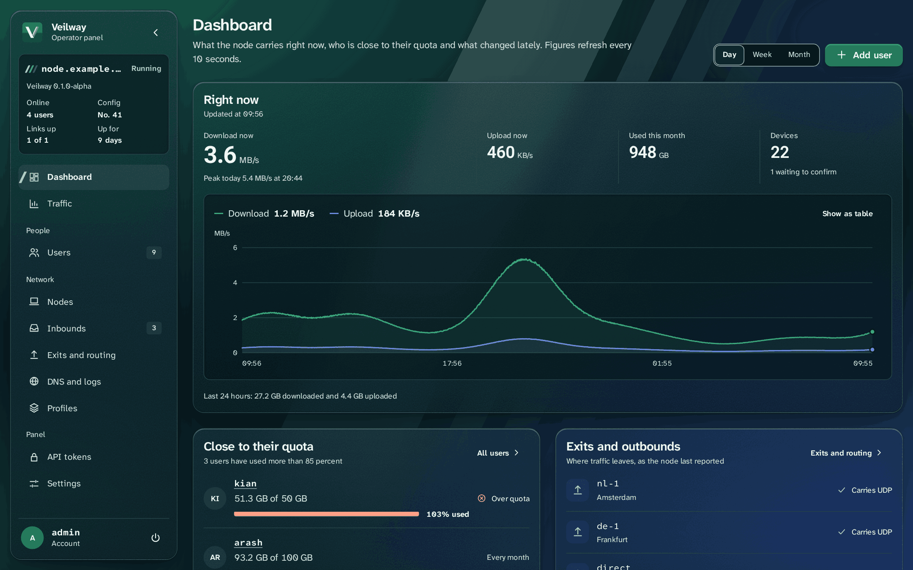
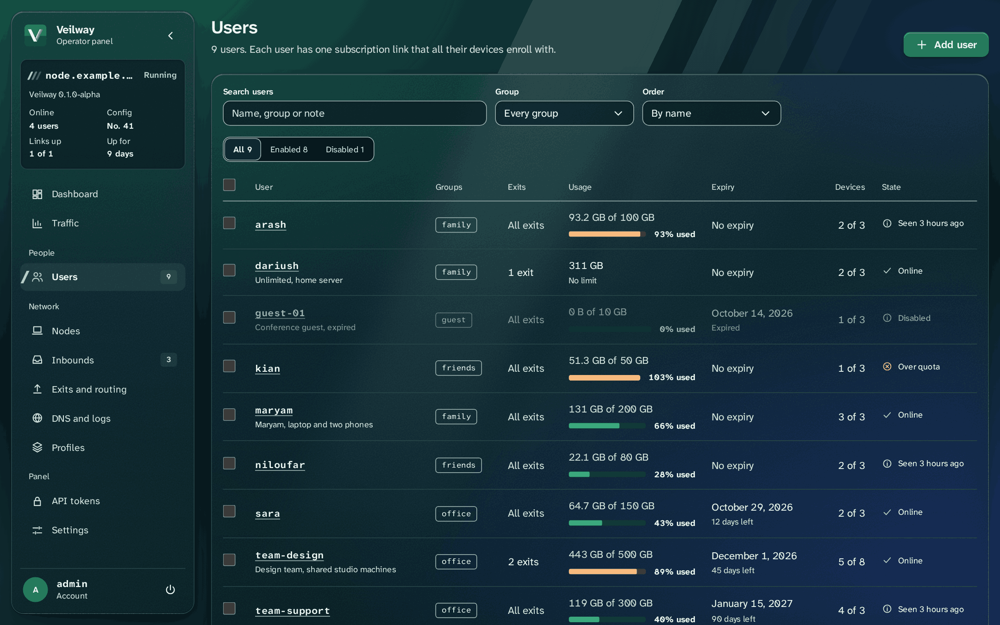
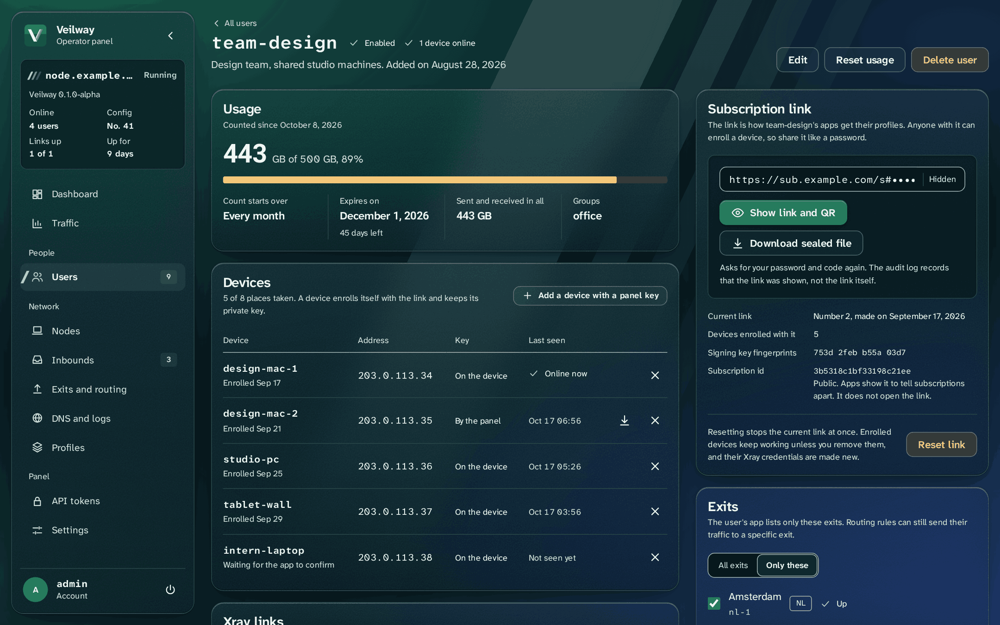
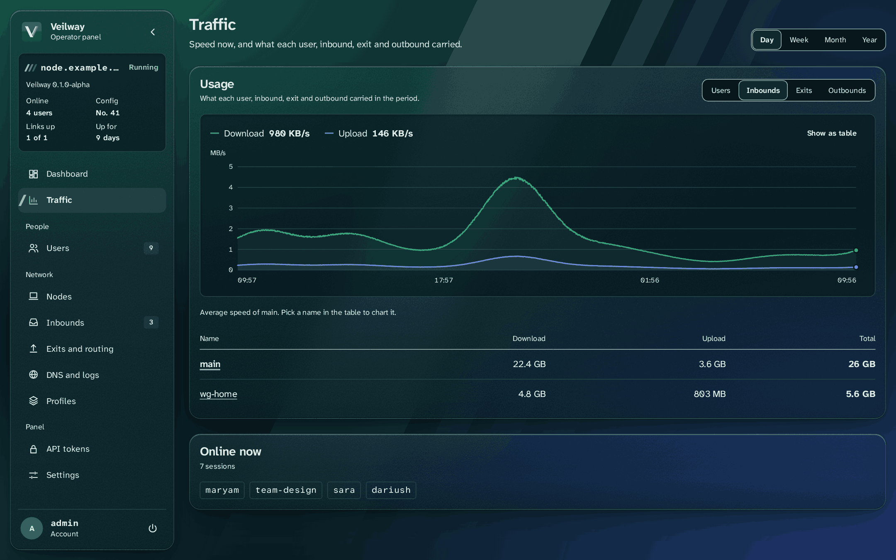
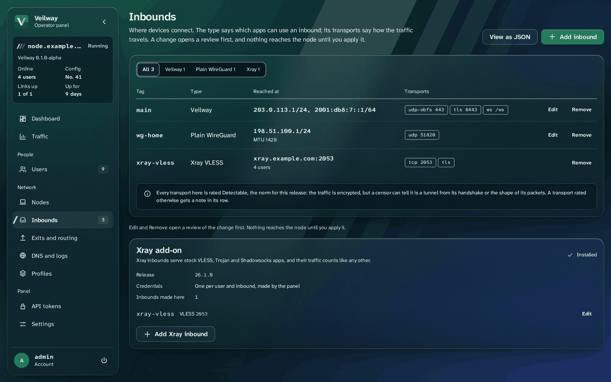
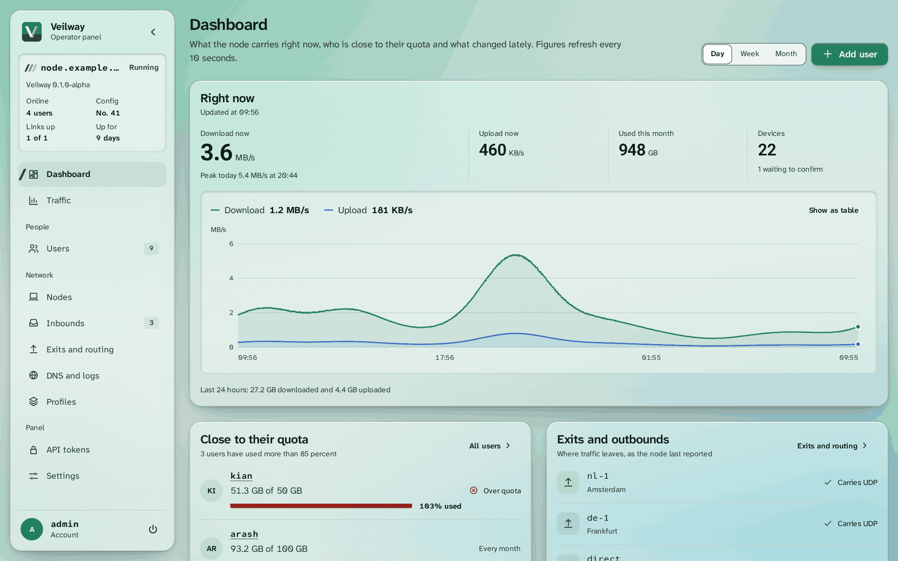

<p align="center">

</p>

<h1 align="center">Veilway panel</h1>

<p align="center">
The admin panel of a Veilway node: users, devices, subscription links and an API.
</p>

<p align="center">
<b>English</b> | <a href="README.fa.md">فارسی</a>
</p>

<p align="center">
<a href="LICENSE"></a>
<a href="https://t.me/VeilwayGroup"></a>
</p>

## Screenshots

The dashboard in the dark theme.



The users list with quotas, expiry and state.



One user: usage, devices and the subscription link.



Traffic per user, inbound, exit and outbound.



Inbounds, native and Xray.



The dashboard in the light theme.



## What it is

Veilway is an open-source VPN platform for people on censored networks. It has a Rust core, a web panel and first-party apps. The panel is the admin side of a node. It is a Rust server with SQLite, plus a React app built into the same binary. It runs on the node's host. It changes users and settings through the node's control API, over its unix socket.

- Users and devices: quotas per period, expiry, groups, enabling and disabling, device keys, usage resets, and subscription links and QR codes.
- Subscriptions and gateway keys: requests and answers are encrypted end to end to the panel's gateway key, so relay mirrors see none of their content. Links carry the gateway key. The panel has a page for rotating a key, and for a key that was stolen or lost. Named endpoints are reached at `sub_path/<name>`. You can assign them per user and per group, and a move between them is signed. An endpoint may be plain `http://`. The panel warns when one is.
- Inbounds, exits and routing: native inbounds and the optional Xray add-on. Keys are made with a Generate button. Each inbound has its own addresses. There is a default exit, with exits per user. Routing rules are reordered by drag and drop. A raw JSON editor checks each change against the schema.
- Several servers: other servers join through node links, each with its own address pool. A user's subscription lists the servers they may use, and usage is added up across them, with a cut on every server at the quota.
- Node links and mirrors: guided setups for an entry node and a reverse tunnel, relays, and relay and static mirrors. The node address and relay addresses may be IP addresses or host names. The panel looks a name up when it makes a user's subscription, so apps always get IP addresses.
- Traffic, DNS, logs and notices: live and past traffic per user, inbound, exit and outbound. Also DNS settings, logs, and notices to every device.
- Admins and access: sign-in with a password and a TOTP code, sessions, rate limits, API tokens, and an audit log. The admin API is described by `server/openapi.json`.
- Operations: backup and restore. Update buttons for the panel and the node. Restart buttons on the Nodes page. Installs made with the install script get these, and the updater keeps the script current too. Links to your own terms and privacy pages. A demo mode with two-step sign-in off (`"two_step": "off"` in `panel.json` only), which logs a warning. English and Persian, in light and dark themes.

## Who it is for

Operators who run a Veilway node and want to manage its users from a browser or from scripts. Your web server stays in front of the panel. It terminates TLS, forwards the admin path and the subscription path, and answers every other path with its own 404. The panel listens on loopback only, and it sets secure cookies.

## Status

> **Alpha.** The current release is `v0.3.9-alpha`. The server and the web app run against a real node in the alpha gate. The panel has had no outside security review. Downloads are on the [releases page](https://github.com/veilway-project/veilway-panel/releases). Manuals and release notes are on the [docs site](https://veilway-project.github.io/veilway-docs/).

## Quick start

The install script is the recommended way. It installs the node, the panel or both. It checks every download, and it can set up the web server for you:

```
curl -fsSL https://raw.githubusercontent.com/veilway-project/veilway/main/scripts/veilway.sh | sudo bash
```

The [install guide](https://veilway-project.github.io/veilway-docs/getting-started/) has the details. [First inbound and user](https://veilway-project.github.io/veilway-docs/guides/first-user/) goes from the first sign-in to a user's link. To run the panel from source instead, build it first (see below). Then, in `server/`:

1. Write `panel.json`. Every key is optional. But the panel refuses to start unless `trusted_proxies` lists your web server. If no proxy is in front of the panel, set `direct` to `true` instead. Set `prefix` to a long random path. It is the admin path. Set `not_found` to the status, headers and body of your web server's 404, copied as they are.
2. Start the panel:

```
cargo run -- run --config panel.json
```

On the first start, the panel prints a one-time setup token to the console. Keep it private.

3. Create the first admin account. Send the token with a username, a password and `"accepted_terms": true` to `{prefix}/api/setup`. The panel requires you to accept the Veilway terms at setup. The answer holds a TOTP secret. Add it to an authenticator app, then sign in with the code.
4. Before you add users, set the node address, the endpoint URL and the address pool under Settings. Then add an inbound and publish its profile. The Generate buttons make the inbound's private key and transport key. The panel fills in the public halves, so you do not need to run `veilway genkey`.
5. Open `{prefix}` in a browser to sign in.

## Build from source

Clone the core repository next to this one. The server reads `veilway-proto` from `../../veilway/crates`, so the two folders must sit side by side:

```
git clone https://github.com/veilway-project/veilway
git clone https://github.com/veilway-project/veilway-panel
cd veilway-panel
```

Run the tests in Docker:

```
docker run --rm --cpus 3 --memory 3g -v "$PWD":/w/veilway-panel -v "$PWD/../veilway":/w/veilway -v veilway-cargo:/usr/local/cargo/registry -v veilway-target-usage:/t -w /w/veilway-panel/server -e CARGO_TARGET_DIR=/t/target/panel rust:1 sh -c "cargo test"
```

After you change a route or a type, regenerate `server/openapi.json` with the same command. Replace `cargo test` with `sh -c "cargo run -- openapi > openapi.json"`. A test fails when the file is stale.

## Run with Docker

The install script is the recommended way. Docker is an option. Images for linux/amd64 and linux/arm64 are published to `ghcr.io/veilway-project/veilway-panel` on each `v*` tag. The image runs as a non-root user. Its config and data live in volumes. The panel listens on `127.0.0.1` only. So you need a web server with TLS in front of it, and the panel needs the node's control socket.

Run the container with a restart policy: `--restart unless-stopped`, or `restart: unless-stopped` in compose. After a restore from a backup, the panel stops by itself with exit code 75. The restart policy then starts it on the restored files. Without a policy, it stays stopped. The update button does not work in a container. Pull the new image instead.

[deploy/compose](https://github.com/veilway-project/veilway/tree/main/deploy/compose) in the core repo runs the node and the panel together. It has the steps for the config, the socket volume and the web server.

## The API

The admin API sits under `{prefix}/api`. The route table in `server/src/routes.rs` builds both the router and `openapi.json`. So the file always matches the running code.

API tokens let a script call the admin API. A token never reaches the routes that need a full admin session or re-authentication.

## Security notes

- Admin sign-in asks for a TOTP code as well as the password. Passwords are hashed with Argon2id.
- The panel checks the host and origin of admin requests. `allowed_hosts` lists the host names it accepts.
- `trusted_proxies` lists the proxies whose forwarded address the panel believes. Keep it to your own web server.
- Three files are kept apart, and only their owner can read them (mode 600). The database holds no key. `panel.keys` holds the token and secret keys. `signing.keys` holds the subscription signing keys. Back up `panel.keys` on its own. Without it, the subscription endpoint answers like an unknown path, and no secret opens.
- `gateway.keys` holds the gateway keys that open subscription requests. The panel's backup includes it. The private half of the next key is written once to `gateway.next`, so you can move it off the server and keep it.
- The panel has no TLS of its own. It refuses to start on a non-loopback `listen`, and its cookies are secure.
- The subscription endpoint looks like your web server's own 404. The `not_found` setting copies that answer, so a stranger cannot tell the endpoint from any other missing path.
- The audit log never holds a link, token or key.

## Repositories

- [veilway](https://github.com/veilway-project/veilway): the core, the control API and its TypeScript client, and the desktop and Android apps.
- [veilway-ui](https://github.com/veilway-project/veilway-ui): the design system and the translations shared by the panel and the apps.
- [veilway-docs](https://github.com/veilway-project/veilway-docs): protocol spec, config reference and manuals, in English and Persian. The site is at [veilway-project.github.io/veilway-docs](https://veilway-project.github.io/veilway-docs/).
- veilway-panel: this repository.

## Contributing and security

Questions and help with setup go to [GitHub Discussions](https://github.com/veilway-project/veilway/discussions), in English or Persian. Issues are for bugs and concrete feature requests.

Read [CONTRIBUTING.md](CONTRIBUTING.md) first. Your first pull request asks you to sign the [CLA](CLA.md) once. Report vulnerabilities privately, as described in [SECURITY.md](SECURITY.md). Never report them in a public issue.

## License

Apache-2.0. See [LICENSE](LICENSE) and [NOTICE](NOTICE). The license does not cover the name. See [TRADEMARKS.md](TRADEMARKS.md).
